# Architecture — the `sustainability-data` Well-Known URI project

This document is the master architecture reference for the whole repository: the
protocol defined by the Internet-Draft, the two reference implementations
(publisher gateway and consumer client), the formal-schema layer, the deployment
topologies, and the CI/verification architecture that keeps them provably in sync.

Diagrams follow the [C4 model](https://c4model.com/) conventions (Level 1 System
Context → Level 2 Container → Level 3 Component), written in
[Mermaid](https://mermaid.js.org/) and rendered to PNG. Every diagram appears
inline (Mermaid source) and as a pre-rendered image in [`images/`](images/); the
sources live in [`diagrams/`](diagrams/).

**Ground truth**: [`internet-drafts/draft-besleaga-sustainability-wellknown-12.md`](../internet-drafts/draft-besleaga-sustainability-wellknown-12.md)
(the latest posted draft is **`-12`**, with the wire format of `-10`; [§3](#3-the-protocol-subsystem) says what changed,
and [`internet-drafts/README.md`](../internet-drafts/README.md) holds the full revision history), with [`internet-drafts/draft-besleaga-sustainability-wellknown-06.md`](../internet-drafts/draft-besleaga-sustainability-wellknown-06.md)
kept as the historical reference for the prior posted revision
(2026-09-10, the "2.0"-labeled `sustainability-data` URI rename), [`../README.md`](../README.md),
[`publisher/src/`](../publisher/src/), [`consumer/src/`](../consumer/src/),
[`schemas-validators/`](../schemas-validators/),
[`server-configurations/`](../server-configurations/),
[`example-scripts/`](../example-scripts/), [`.github/workflows/`](../.github/workflows/).

---

## Table of contents

1. [System context](#1-system-context-c4-level-1)
2. [Container view](#2-container-view-c4-level-2)
3. [The protocol subsystem](#3-the-protocol-subsystem)
   - [Wire-protocol lifecycle](#31-wire-protocol-lifecycle)
   - [Data model](#32-data-model-26-members)
   - [Versioning and legacy-compatibility state logic](#33-versioning-and-legacy-compatibility-state-logic)
4. [Publisher subsystem — the universal gateway](#4-publisher-subsystem--the-universal-gateway)
5. [Consumer subsystem](#5-consumer-subsystem)
6. [Deployment topologies](#6-deployment-topologies)
7. [Supporting subsystems](#7-supporting-subsystems-schemas-example-scripts-server-configs)
8. [CI / verification architecture](#8-ci--verification-architecture)
9. [Sources](#9-sources)

---

## 1. System context (C4 Level 1)

**What the system is.** The Internet-Draft
`draft-besleaga-sustainability-wellknown` defines a single, fixed, discoverable
HTTPS location — `/.well-known/sustainability-data` (RFC 8615) — where any HTTP
origin publishes its aggregated energy-consumption and carbon-footprint metrics
as machine-readable JSON. Reporting is out-of-band and asynchronous: no
per-request headers, no rebound effect, standard HTTP caching.

**Who publishes.** The *provider* — "the entity operating the origin" — which is
deliberately broader than a web server paying its own electricity bill: a
website, an API, an IoT/embedded device, a Web3 RPC gateway, or an organization
surfacing CSRD/ESRS-E1/MiCA-grade figures from its enterprise carbon-accounting
platform. The reference publisher's enterprise adapters (Salesforce Net Zero
Cloud, Microsoft Sustainability Manager, Watershed) are written to publish exactly such
organization-level figures through the same endpoint; they run in the gateway against
recorded responses, none has been exercised against a live tenant, and the Microsoft
adapter targets a preview API retired 2025-05-30.

**Who consumes** — the draft is designed to be usable, unchanged, in four
consumption contexts at once:

| Consumer | Mode | What they rely on |
|---|---|---|
| Regulators / auditors | Web + human | Fixed URI, self-describing member names, mandatory `methodology-uri`, links to attestations/disclosures |
| Aggregators / crawlers | M2M | Stable JSON wire format, formal CDDL + JTD schemas, deterministic query semantics, CORS `*` |
| Carbon-aware tooling (schedulers, dashboards) | M2M | HTTP caching + `ETag` conditional requests for cheap polling |
| AI agents | Automated | Machine-discoverable at a fixed location, schema-validatable, safe to ingest without negotiation |

**Surrounding ecosystem.** A provisional registration request for the `sustainability-data`
well-known URI is open with IANA ([well-known-uris#95](https://github.com/protocol-registries/well-known-uris/issues/95);
the suffix was renamed from `sustainability` in the `-04` revision, per ISE
feedback on RFC 8615 precision).
The Green Web Foundation **carbon.txt** convention composes bidirectionally with
this system: a metrics document may point at a carbon.txt disclosure index via
`disclosure-uri`, and the publisher can serve a carbon.txt that points back at
the metrics endpoint.


*Source: [`diagrams/c4-context.mmd`](diagrams/c4-context.mmd)* — a `graph TD`
equivalent of a C4 System Context diagram (see [Sources](#9-sources) for why).

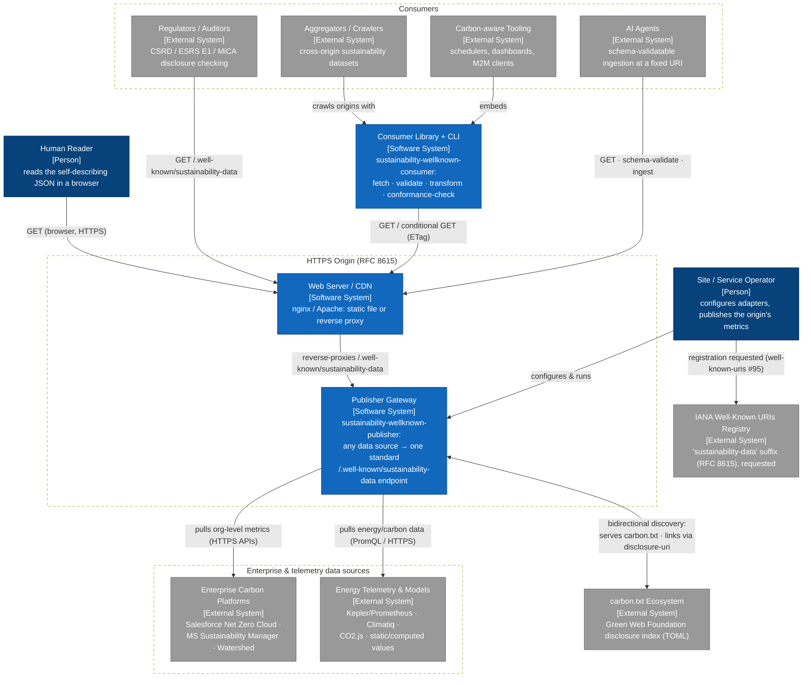

---

## 2. Container view (C4 Level 2)

In C4 terms a *container* is "an application or a data store — a separately
runnable/deployable unit" ([c4model.com/abstractions](https://c4model.com/abstractions)).
The reference implementation decomposes into:

| Container | Location | Role |
|---|---|---|
| **Source Adapters** | `publisher/src/adapters/` | 12 pluggable `SourceAdapter` factories turning any upstream into `RawMetrics` |
| **Publishing Pipeline** | `publisher/src/{normalize,security,validate,publisher}.ts` | normalize → safeguards → JTD validation gate → bounded cache + ETag |
| **HTTP Layer** | `publisher/src/{handler,server,middleware/*,cli}.ts` | one framework-agnostic handler behind a standalone server, Express/Fastify middleware, and a CLI |
| **carbon.txt Module** | `publisher/src/carbontxt.ts` | emit / parse / discover a bidirectional carbon.txt |
| **Fetch + Validate Library** | `consumer/src/{fetch,validate,schema,sentinel}.ts` | hardened one-call client with defensive validation |
| **SustainabilityClient** | `consumer/src/client.ts` | ETag-cached polling client |
| **Transforms** | `consumer/src/{transform,units}.ts` | CSV / NDJSON / flatten / total |
| **sustainability-fetch CLI** | `consumer/src/cli.ts`, `consumer/bin/` | M2M fetch + `--strict` conformance battery |
| **Formal Schemas + Validators** | `schemas-validators/` | CDDL (RFC 8610) + JTD (RFC 8927) with Python/Ruby validators |
| **Web Server Deployments** | `server-configurations/` | nginx/Apache snippets: static file or reverse proxy |
| **Example Scripts** | `example-scripts/` | zero-dependency safeguards + reference request handler (Python/JS/PHP) |

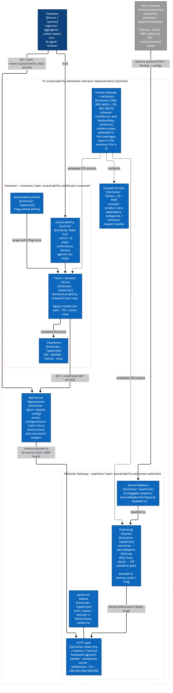

*Source: [`diagrams/c4-container.mmd`](diagrams/c4-container.mmd)*

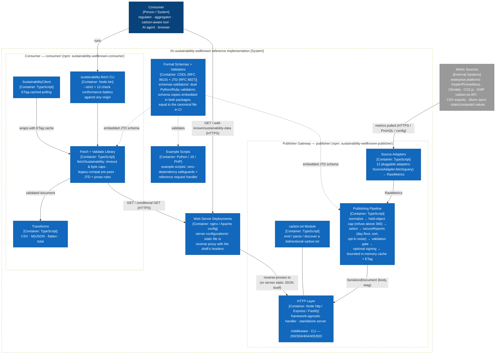

---

## 3. The protocol subsystem

The normative artifact is the Internet-Draft (`internet-drafts/`).

> **Current wire format, `-10` (posted 2026-10-24).** The members are those of `-07` (7 mandatory, 19 optional), with these
> changes since `-08`: `reporting-period` is replaced by `period`, an object of two RFC 3339 `date-time` values (`start`
> included, `end` excluded, bounds compared as instants); the query parameters are `target`, `start`, `end` (UTC
> date-times) and `granularity` (`yearly`, `monthly`, `daily`); a server returns the objects it holds that satisfy every
> parameter it honors, as an array in ascending order of `period.start`, empty when none does, and computes no aggregate;
> a parameter it does not support, or a value that does not match the grammar, is ignored (there is no `400` and no
> `404` for a query); `measurement-method`, `functional-unit`, `carbon-unit` (`gCO2e`, `kgCO2e`, `tCO2e`), `target-type`
> and the `upstream` `role` are closed sets; the signature algorithm is `Ed25519` (or `ES256`); URI-valued members are
> URI references. The reference codebase (`publisher/` 0.8.2, `consumer/` 0.8.2, `gateway/` 0.3.0,
> `schemas-validators/`) implements `-10`. The paragraphs and diagrams below that describe `-07` query rules (the
> seven-step procedure, `400`/`404` cases, aggregation) are the record of `-07`; the publisher's 366-object cap is a
> deployment safeguard, not a requirement of the draft.

**`-07` (posted 2026-09-17) defined the wire format that `-08` kept.** Since `-06` it: withdraws the companion
`sustainability-data.jws` resource and its detached signature entirely, in
favor of an OPTIONAL `signed` member embedded in each declaration object (a
JWS Compact Serialization over the object itself, typed by `cty`); removes the
`version` member outright (seven members are now mandatory, not eight) and
closes the top-level member set; replaces reverse-domain private extension
members with a single OPTIONAL `extensions` object keyed by an absolute URI
(RFC 3986) — an `https` URI under the definer's control, which should identify
documentation of the extension, or `urn:uuid:` plus a lowercase hyphenated UUID
(RFC 9562) for a definer without a domain, compared as a string and never
dereferenced; adds an OPTIONAL `upstream` member linking to the declarations of
providers a subject's figures derive from; drops the "unauthenticated/free
methodology resource" fallback from the minimum-reporting rule; specifies
Extended Query Parameters as ABNF plus a numbered procedure (duplicate
parameter ⇒ 400, malformed `period` ⇒ 400, `target` outside the published
prefix set ⇒ 404); removes the server-side "cap at 366" MUST/RECOMMENDED in
favor of a consumer-side bound; and removes the `X-Content-Type-Options:
nosniff` recommendation. See the draft's own Changelog appendix for the full
list.
**`-06`** (schema `2.0`) is an *earlier posted revision* —
posted to the Datatracker 2026-09-10 (superseded by `-07`, posted 2026-09-17; the latest posted revision is `-12`): it requires the
dedicated `application/sustainability-data+json` media type, raises HTTPS
from SHOULD to MUST, added `X-Content-Type-Options: nosniff` and the
now-withdrawn detached JWS, with no wire-format change from `-05`. Earlier
revisions **-05** (posted 2026-07-28), **-04** (URI suffix renamed to
`sustainability-data`, optional `target-type` member added) and **-03**
(posted 2026-07-23) are prior history; the schema label was `2.0` from `-03`
through `-06` and is removed entirely in `-07`. The prose below
describes the `-07` wire protocol where it says so; the diagrams and the reference codebase
(`publisher/` 0.8.2, `consumer/` 0.8.2, `schemas-validators/`, the gateway 0.3.0)
follow `-10`, as the note at the top of this section says. Two habits of the implementations are not `-07` requirements
and are labelled as such where they appear: the publisher keeps a defensive
366-object cap, and the servers still send `X-Content-Type-Options: nosniff`.
Field-driven compatibility for historical `1.x` documents (§3.3) does not
depend on any of this and remains current.

### 3.1 Wire-protocol lifecycle

Two service levels:

* **Basic (mandatory minimum)** — the declaration is the representation of the
  well-known URI: a `200 OK` to a parameterless `GET` carries it (one object or
  an array), media type `application/sustainability-data+json`; methods, status
  codes and `HEAD` are as RFC 9110 defines them (the draft cites it rather than
  restating `404`/`405`). An origin that publishes no declaration has no
  representation at the well-known URI.
* **Extended (optional)** — three query parameters: `target` (path-prefix
  scoping, honored only for a deliberately published prefix set — a
  path-disclosure and cache-key-space defense), `period` (`YYYY` / `YYYY-MM` /
  `YYYY-MM-DD`), and `granularity` (`monthly` / `daily`). *(`-07`; in `-10` they are `target`, `start`, `end` and
  `granularity`, as the note at the top of this section says.)* A granularity finer
  than the period yields a sorted **array** (trend); a `period` alone MUST NOT
  yield an array — a single (possibly aggregated) object, or 404 per the
  no-data rule. A server ignores a parameter it does not support and answers the rest of the
  request — never an error.
  As of `-07`, the syntax is specified in ABNF and processing as a numbered
  seven-step procedure: a duplicate parameter name is rejected with `400`, a
  malformed or non-real `period` is rejected with `400`, an unrecognized or
  too-coarse `granularity` is silently ignored, and a `target` outside the
  published prefix set yields `404`.

Caching is first-class: `Cache-Control: public, max-age=86400` is recommended,
`ETag`/`Last-Modified` enable conditional requests, and the reference publisher
answers a matching `If-None-Match` with `304`. The reference publisher adds one
more state the draft implies: if the pipeline cannot produce a *valid* document,
it answers `503` rather than publish corrupt data.

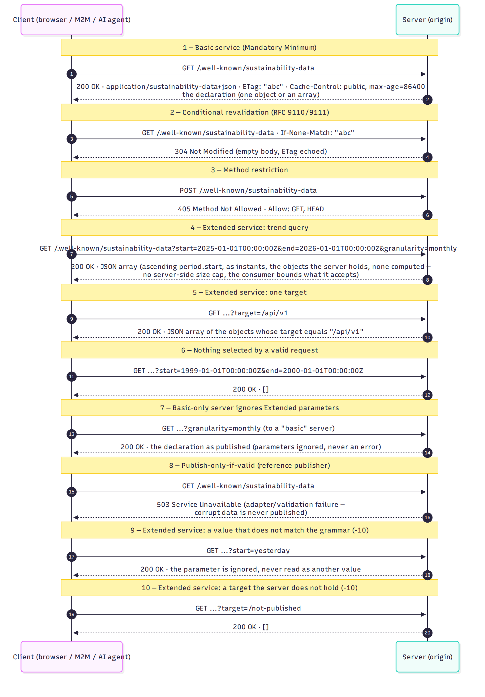

*Source: [`diagrams/protocol-sequence.mmd`](diagrams/protocol-sequence.mmd)*

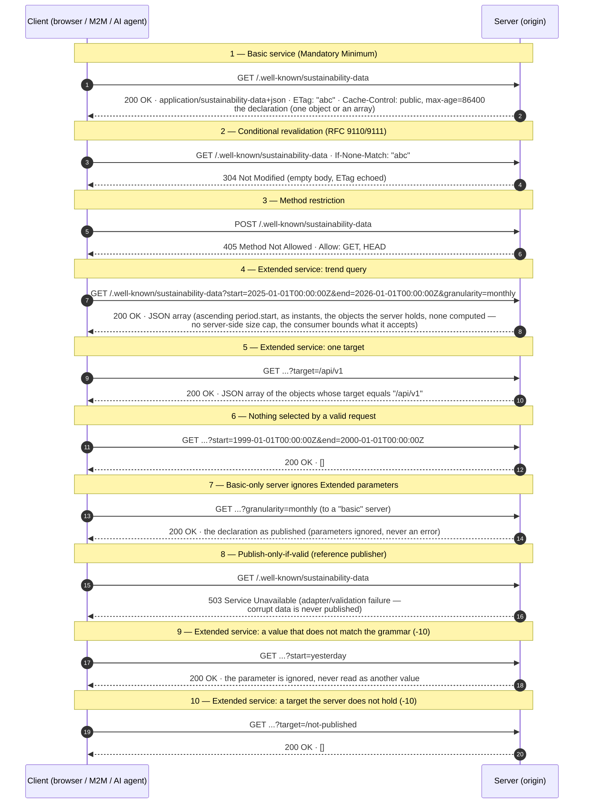

### 3.2 Data model (26 members)

A response is a single `SustainabilityMetrics` object or an array of them; a
consumer accepts both forms, and the objects of an array may cover different
periods and targets of the same origin. **Under `-10` (kept by `-11` and
`-12`), 7 members are mandatory and 19 optional — 26 total**: `updated`,
`capabilities`, `provider`, `measurement-method`, `methodology-uri`, `period`
(an object of two RFC 3339 `date-time` bounds, `start` included, `end`
excluded) and `target` are mandatory. Omission is the only "not reported"
mechanism: a present member always carries a real value, and an object carries
at least one numeric metric or one of `disclosure-uri` and
`verifiable-attestation-uri`. Gross quantities are non-negative;
`renewable-energy` is bounded 0–100 inclusive; `scope-1/2/3` **may** be
negative (removals / net accounting); absent unit members default to `kWh` and
`gCO2e`; `sci-score` requires `functional-unit`. Every token member takes one
of a closed set: `capabilities` (2), `measurement-method` (4), `energy-unit`
(4), `carbon-unit` (`gCO2e`, `kgCO2e`, `tCO2e`), `carbon-accounting` (2),
`functional-unit` (12), the `upstream` `role` (6) and the optional
`target-type` (9: `organization`, `facility`, `origin`, `path`, `service`,
`product`, `device`, `tenant`, `data-source`), which classifies the subject
named by `target` and does not change its syntax or comparison. A value outside
its set makes the document invalid. The consumer's legacy-compatibility
pre-pass reads the period and the `functional-unit` and `carbon-unit`
spellings of a `-08` or `-09` document as their `-10` forms, disregards an
out-of-set `measurement-method` (read as `third-party-modeled`),
`target-type` or `upstream` `role`, and reports each one; an `energy-unit`,
`carbon-accounting` or `capabilities` outside its set stays invalid. The top-level member set is closed: a publisher MUST NOT add
other top-level members, and a consumer ignores one it does not recognize.
Private extension data lives inside the OPTIONAL `extensions` object, keyed by
an absolute URI (an `https` URI under the definer's control, or a `urn:uuid:`
name, RFC 9562), compared as a string, never dereferenced, with no registry.
`upstream` is an array of `{declaration, role?}` objects linking to the
declarations of providers this object's figures derive from, walked by a
consumer at most three declarations deep, refusing revisited URIs, within a
retrieval budget; `signed` is an OPTIONAL embedded JWS (`Ed25519` or `ES256`
RECOMMENDED). The schemas in `schemas-validators/` stay open
(`additionalProperties` / `* tstr => any`) so that a consumer ignores a member
it does not recognize; they define `extensions` and `upstream`, and the
publisher's validation gate refuses a top-level member the draft does not
define.

History in one sentence: `target-type` arrived in `-04` (an unrecognized value
was then tolerated), `-07` removed `version`, closed the member set, replaced
reverse-domain extension names with `extensions` and added `upstream` and
`signed`, `-09` replaced `reporting-period` with `period`, and `-10` made every
date a date-time and every token set closed (`facility` is new).

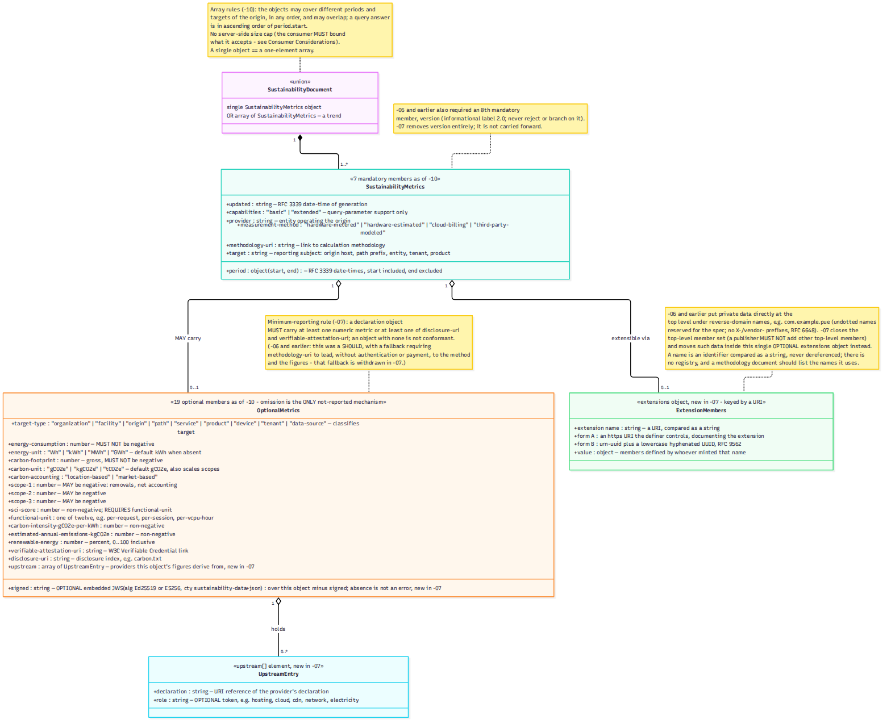

*Source: [`diagrams/data-model.mmd`](diagrams/data-model.mmd)*

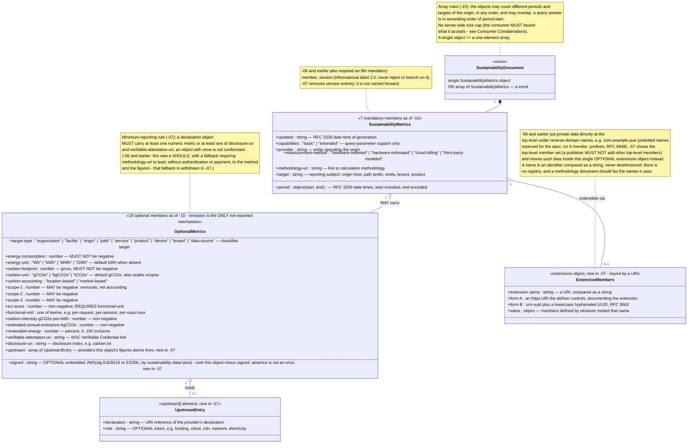

Two more prose rules complete the model:

* **Minimum-reporting rule** — as of `-07`, a declaration object MUST carry at
  least one numeric metric or at least one of `disclosure-uri` and
  `verifiable-attestation-uri`; an object with none is not conformant. (`-06`
  and earlier: this was a SHOULD, with a fallback requiring `methodology-uri`
  to lead, without authentication or payment, to the method and the figures —
  that fallback is withdrawn in `-07`.)
* **Trust posture** — the endpoint *asserts*, it does not *verify*. Clients MUST
  NOT treat the document as proof; `verifiable-attestation-uri` (as of `-07`, a
  verifiable credential attesting one period binds to the declaration by
  embedding a copy of the object, without `signed`, inside `credentialSubject` —
  not a byte hash — while one attesting the derivation model carries that model
  instead, as Appendix A's deployment does),
  `disclosure-uri` (e.g. carbon.txt), and a verified `signed` member are the
  composable paths to independent verification, none of them proof.

### 3.3 Versioning and legacy-compatibility state logic

Through `-06`, the `version` member was an informational label with **no
negotiation semantics** — clients MUST NOT reject or branch on it. **`-07`
removes the `version` member entirely**; the mandatory-member count drops to
seven (§3.2), and a consumer that still receives it on an older document MUST
simply ignore it, per the general forward-compatibility rule. Interop with
historical `1.0`/`1.1` documents (the submitted `-02` model: four mandatory
metric members, negative "not reported" sentinel, optional `target-path`) is
achieved entirely through two **field-driven** rules, neither of which reads
`version`, so both are unaffected by its removal:

1. A negative value in a member defined as non-negative ⇒ treat that member as
   *not reported* (subsumes the historical sentinel).
2. A document without a `target` member ⇒ treat as an *origin-wide* report
   (what the historical absence of `target-path` conveyed).

The same diagram tracks the draft's own revision lifecycle, from the renamed
predecessor series through `-02`, `-03` and `-04` (URI suffix renamed to
`sustainability-data`, optional `target-type` added) to `-06`, the prior
posted revision (media type required, HTTPS MUST, `nosniff`, the
now-withdrawn OPTIONAL detached JWS), to `-07`
(2026-09-17: embedded `signed` member, `version` removed, closed
member set, `extensions` by absolute URI, `upstream`, `nosniff` recommendation
withdrawn — §3), `-08` (2026-10-09, prose only), `-09` (2026-10-16, the `period` object),
`-10` (2026-10-24: date-time bounds, closed token sets), `-11` (2026-10-27, editorial) and `-12`, the latest posted revision (2026-10-28, editorial),
and the eventual Informational RFC + IANA registration.

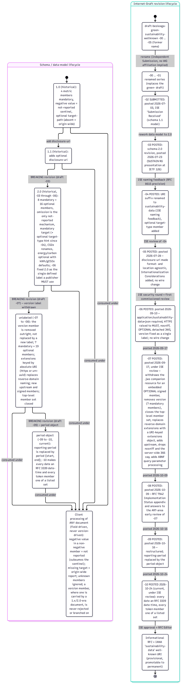

*Source: [`diagrams/version-state.mmd`](diagrams/version-state.mmd)*

```mermaid
stateDiagram-v2
    state "Schema / data-model lifecycle" as SCHEMA {
        state "1.0 (historical): 4 metric members mandatory, negative value = not-reported sentinel, optional target-path (absent = origin-wide)" as V10
        state "1.1 (historical): adds optional disclosure-uri" as V11
        state "2.0 (historical, -03 through -06): 8 mandatory + 16 optional members, omission is the only not-reported mechanism, mandatory target (+ optional target-type hint since -04), CO2e renames, energy/carbon optional with kWh/gCO2e defaults; -06 fixed 2.0 as the single defined label a publisher MUST use" as V20
        state "unlabeled (-07 to -08): the version member is removed outright, not replaced by a new label; 7 mandatory + 19 optional members; extensions keyed by absolute URI (https or urn-uuid) replaces reverse-domain naming; new upstream and signed members; top-level member set closed" as V07
        state "period object (-09 onward): reporting-period is replaced by period {start, end}; -10 makes every date an RFC 3339 date-time and every token member one of a listed set; -11 and -12 keep the -10 wire format (current)" as V10P
        state "Client processing of ANY document (field-driven, never version-driven): negative value in a non-negative member = not reported (subsumes the sentinel); missing target = origin-wide report; unknown members ignored; a version member, where one is carried by a 1.x/2.0-era document, is never rejected or branched on" as COMPAT

        [*] --> V10
        V10 --> V11 : add disclosure-uri
        V11 --> V20 : BREAKING revision (draft -03)
        V20 --> V07 : BREAKING revision (draft -07) — version label withdrawn
        V07 --> V10P : BREAKING revision (draft -09) — period object
        V10P --> COMPAT : consumed under
        V20 --> COMPAT : consumed under
        V11 --> COMPAT : consumed under
        V10 --> COMPAT : consumed under
        V07 --> COMPAT : consumed under
    }

    state "Internet-Draft revision lifecycle" as DRAFT {
        state "draft-besleaga-green-sustainability-wellknown -00 .. -05 (former name)" as GREEN
        state "-00 .. -01 renamed series (replaces the green- draft)" as EARLY
        state "-02 SUBMITTED: posted 2026-07-03, ISE 'Submission Received' (schema 1.1 model)" as SUBMITTED
        state "-03 POSTED: schema 2.0 revision, posted 2026-07-23 (SUSTAIN RG presentation at IETF 126)" as POSTED
        state "-04 POSTED: URI suffix renamed to sustainability-data (ISE naming feedback), optional target-type member added" as POSTED4
        state "-05 POSTED: posted 2026-07-28 — disclosure-uri made format- and location-agnostic, Internationalization Considerations added; no wire change" as POSTED5
        state "-06 POSTED: posted 2026-09-10 — application/sustainability-data+json required, HTTPS raised to MUST, nosniff, OPTIONAL detached JWS, version fixed as a single label; no wire change" as POSTED6
        state "-07 POSTED: posted 2026-09-17, under ISE review — withdraws the .jws companion resource for an embedded OPTIONAL signed member, removes version (7 mandatory members), closes the top-level member set, replaces reverse-domain extensions with a URI-keyed extensions object, adds upstream, drops nosniff and the server-side 366 cap, adds ABNF query-parameter processing" as POSTED7
        state "-08 POSTED: posted 2026-10-09 — RFC 7942 Implementation Status appendix and answers to the ART-area early review of -07" as POSTED8
        state "-09 POSTED: posted 2026-10-16 — restructured; reporting-period replaced by the period object" as POSTED9
        state "-10 POSTED: posted 2026-10-24 — every date an RFC 3339 date-time, every token member one of a listed set" as POSTED10
        state "-11 POSTED: posted 2026-10-27 — editorial; the -10 wire format" as POSTED11
        state "-12 POSTED 2026-10-28 (current, under ISE review): editorial; the -10 wire format" as POSTED12
        state "Informational RFC + IANA 'sustainability-data' well-known URI (provisional, promotable to permanent)" as RFC

        [*] --> GREEN
        GREEN --> EARLY : rename (Independent Submission, no WG affiliation implied)
        EARLY --> SUBMITTED
        SUBMITTED --> POSTED : rework data model to 2.0
        POSTED --> POSTED4 : ISE naming feedback (RFC 8615 precision)
        POSTED4 --> POSTED5 : ISE review of -04
        POSTED5 --> POSTED6 : ISE security round + first commissioned review
        POSTED6 --> POSTED7 : posted 2026-09-17
        POSTED7 --> POSTED8 : posted 2026-10-09
        POSTED8 --> POSTED9 : posted 2026-10-16
        POSTED9 --> POSTED10 : posted 2026-10-24
        POSTED10 --> POSTED11 : posted 2026-10-27
        POSTED11 --> POSTED12 : posted 2026-10-28
        POSTED12 --> RFC : ISE approval + RFC Editor
        RFC --> [*]
    }
```

---

## 4. Publisher subsystem — the universal gateway

`publisher/` (npm `sustainability-wellknown-publisher`) is architected as a
**universal gateway**: *any data source in, one standard endpoint out*. The
insight is that enterprises already hold sustainability data in wildly different
systems (carbon-accounting SaaS, Kubernetes energy telemetry, estimation APIs,
spreadsheets); the gateway's adapter layer flattens all of them into one
loosely-typed `RawMetrics` shape, and a single deterministic pipeline turns that
into a draft-conformant document.

**The 12 adapters** (`publisher/src/adapters/`, factory names as registered in
`cli.ts`): `static`, `static-file`, `computed`, `kepler-prometheus`, `climatiq`,
`co2js` (Green Web Foundation CO2.js, bytes → carbon, with Greencheck),
`carbontxt-api` (GWF hosted carbon.txt API), the enterprise trio
`salesforce-nzc`, `ms-sustainability`, `watershed`, and `csv` (an ESG tool's
export) and `slurm-sacct` (HPC job accounting). Every adapter implements the
same three-property contract: `{ name, capabilities, fetch(query) }`.

**Pipeline stages** (orchestrated by `Publisher.build()` in `publisher.ts`):

1. **`adapter.fetch(query)`** → `RawMetrics | RawMetrics[]`.
2. **`normalize()`** (`normalize.ts`) — joules→kWh and full unit conversion
   (`Wh…GWh`, `g…tCO2e`), carbon derived from energy × grid intensity when
   absent, defaults (`capabilities "basic"`, `updated` now; the `-06`-era
   `version "2.0"` default is gone with the member itself, see §3),
   the mandatory `target` (adapter value or configured fallback), and hard
   errors on constraint violations (negative gross metrics, `renewable-energy`
   outside 0–100, `sci-score` without `functional-unit`, malformed periods).
3. **Cap, selection and `secureReports()`** (`security.ts`, `selection.ts`) —
   `assertHeldWithinCap()` refuses to build when the adapter holds more than
   `maxObjects` objects (366 by default; a deployment safeguard, since `-07`
   the draft bounds the consumer instead, see §3) and never truncates an
   answer; when a parameter is honored, `selectDeclarations()` keeps the
   objects that satisfy it; then the operational safeguards: drop entries
   below the day floor (by default, with a warning), sort ascending by
   `period.start`, optional deterministic ~±1% multiplicative noise
   (anti-fingerprinting, only with `noiseDisclosed`; same factor per period so
   scopes still sum to the footprint and re-generation is stable for caching).
4. **Shape rule** — a request that honors a parameter gets an array, empty
   when nothing matches. One that honors none gets what is held: an Extended
   publisher answers with the array (the latest object with
   `representation: "single"`), a Basic one with the object or array the
   adapter returned. Nothing to serve from a Basic publisher, or from one with
   `representation: "single"` ⇒ `NotFoundError` ⇒ HTTP 404.
5. **JTD validation gate** (`validate.ts`) — every payload is validated against
   the embedded schema *plus* the prose rules JTD cannot express (non-negativity,
   0–100, sci↔functional-unit dependency, finite numbers, RFC 3339 `updated`,
   period shape, cross-entry array rules). Failure throws ⇒ HTTP **503**: the
   gateway never publishes corrupt data.
6. **Cache + serialize** (`publisher.ts`) — bounded in-memory cache (default TTL
   24 h, ≤256 client-controlled query variants — the bound is itself a memory-DoS
   defense) storing `{body, etag}` with a SHA-1 ETag.
7. **HTTP** (`handler.ts`) — one framework-agnostic `handleRequest()` produces
   `200/304/404/503` with `Cache-Control`, CORS and RFC 9110 `If-None-Match`
   handling; the standalone server (`server.ts`) adds `405 + Allow: GET, HEAD`
   and optional `carbon.txt` serving; Express/Fastify middleware and the CLI
   (`--once` for static generation) reuse it unchanged.

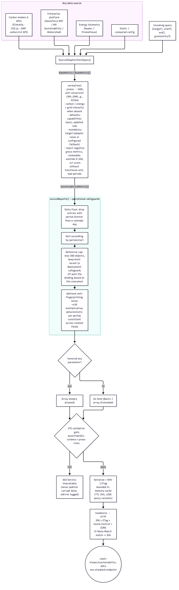

*Source: [`diagrams/gateway-flow.mmd`](diagrams/gateway-flow.mmd)*

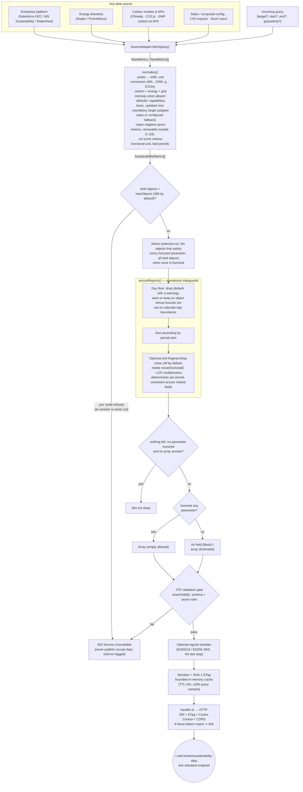

### Publisher component map (C4 Level 3)

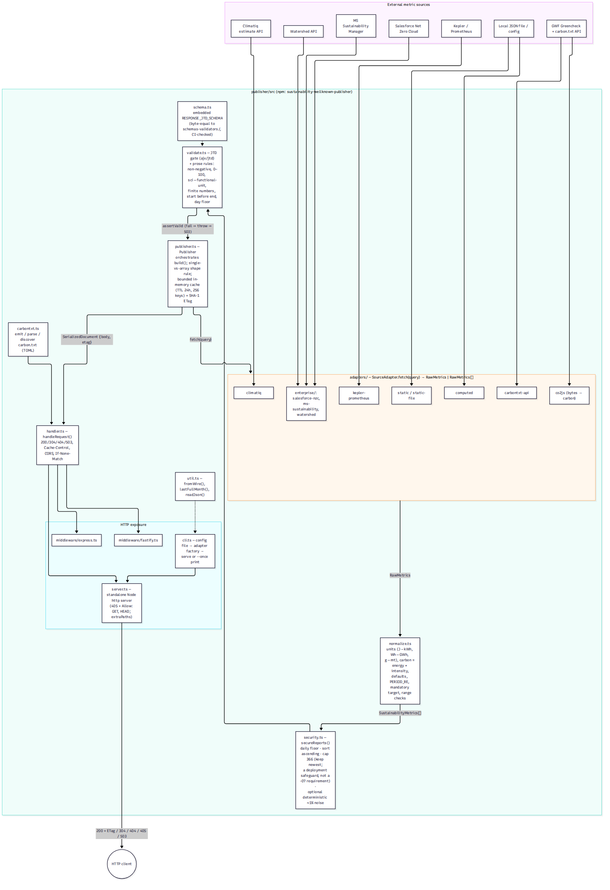

*Source: [`diagrams/c4-component-publisher.mmd`](diagrams/c4-component-publisher.mmd)*

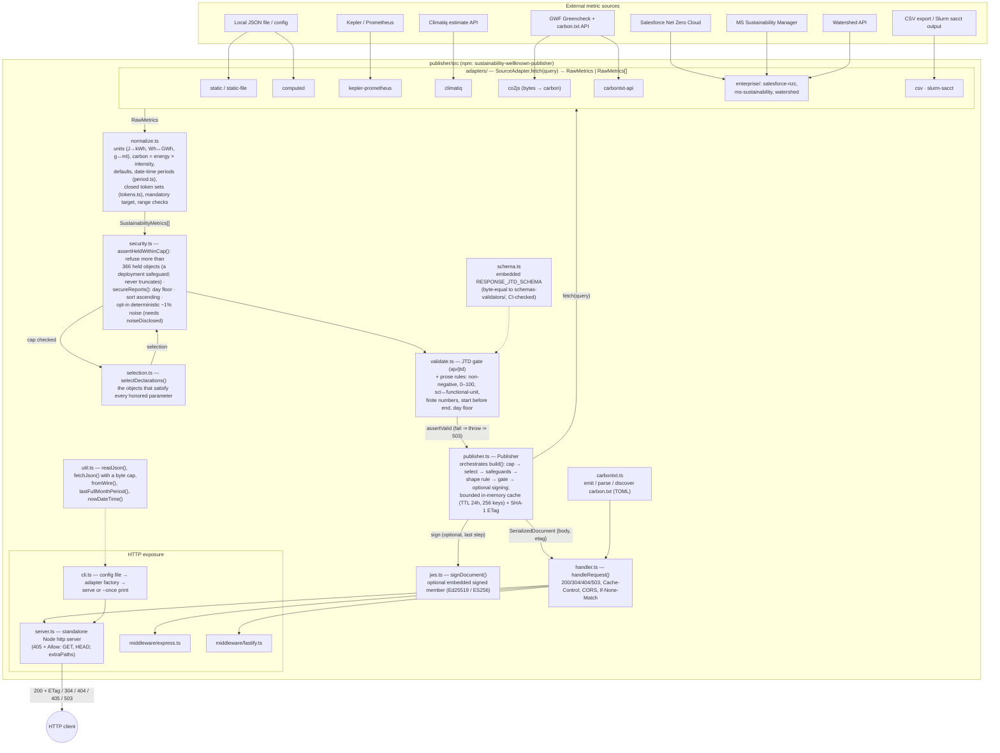

---

## 5. Consumer subsystem

`consumer/` (npm `sustainability-wellknown-consumer`) is the reference *client*:
fetch, **defensively** validate (a non-conformant upstream is the expected case
in early adoption), and transform. Three tiers:

1. **`fetchSustainability(origin, options)`** — one call, zero extra
   dependencies. Hardened against hostile origins: overall timeout (default
   30 s via `AbortSignal.timeout`), a 10 MB body cap enforced *while streaming*
   (a lying `Content-Length` cannot force buffering), JSON parse guard, then the
   validation gate. Results are a typed status union — `ok · not-modified ·
   not-found · no-report · invalid · http-error · timeout · too-large ·
   insecure-transport` — so callers never
   see exceptions for ordinary protocol outcomes.
2. **`SustainabilityClient`** — repeated polling with a bounded per-
   (origin + params) ETag cache; a `304` transparently replays the cached
   document; `getTrend()` asserts the array shape.
3. **CLI `sustainability-fetch`** — JSON/CSV/NDJSON output, plus `--strict`,
   which runs the **12-check conformance battery** (`conformance.ts`; levels and
   sample output in [consumer/USAGE.md §5](../consumer/USAGE.md#5-conformance-checking-any-origin))
   against *any* implementation: a schema-valid Basic declaration · media type (`application/sustainability-data+json`;
   legacy `application/json` ⇒ WARN, not FAIL) · the OPTIONAL embedded `signed`
   member absent, or present and verifiable over the object it accompanies ·
   signature algorithm `Ed25519` or `ES256` · ETag present · fresh ETag ⇒ 304 ·
   POST ⇒ 405 + `Allow` · a query value outside the profile ignored · a range
   that selects nothing ⇒ `200` · `capabilities` `extended` when a parameter is
   honored · an Extended range request yields a valid (sorted-array-when-honored)
   response · whole calendar periods (informational). The `-06`-era
   `X-Content-Type-Options: nosniff` and detached-`.jws` checks are gone with
   the provisions behind them (see §3). The battery
   deliberately disables the legacy-compat pre-pass so it sees the document
   exactly as served. Beyond `--strict`, the CLI also offers `--verify` (the
   embedded signature), `--upstream` (the bounded chain walk and comparison)
   and `--verify-attestation` (the linked credential).

The **legacy-compat pre-pass** in `fetch.ts` implements the draft's
"missing `target` ⇒ origin-wide" rule before the schema gate: the injected host
comes from the *final* response URL (redirects MUST be attributed to the final
origin), and the result is flagged `legacy: true`. `sentinel.ts` implements the
other compatibility rule for values (out-of-range ⇒ not reported; scopes exempt),
which `transform.ts` honors when flattening and aggregating. `disclosure.ts` is
deliberately passive — disclosure/attestation URIs are never fetched
automatically (SSRF posture; the draft's "MUST NOT treat as proof").

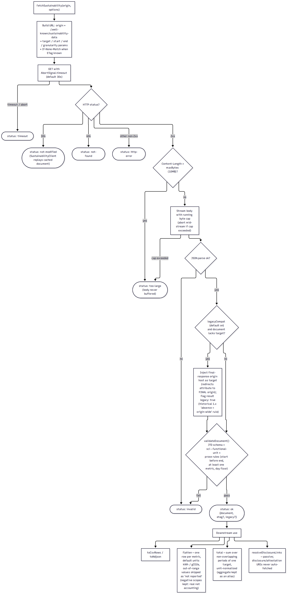

*Source: [`diagrams/consumer-flow.mmd`](diagrams/consumer-flow.mmd)*

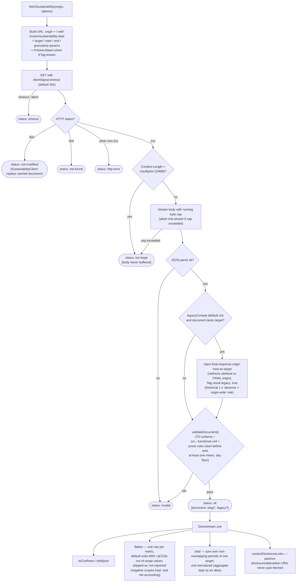

### Consumer component map (C4 Level 3)

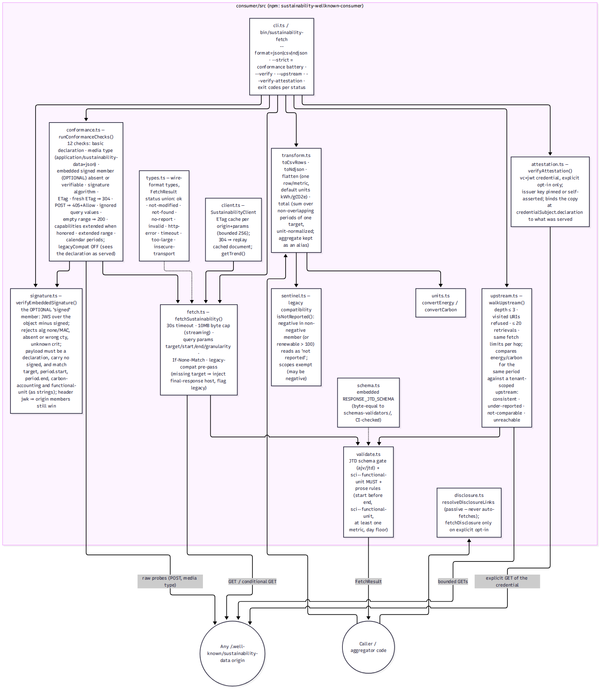

*Source: [`diagrams/c4-component-consumer.mmd`](diagrams/c4-component-consumer.mmd)*

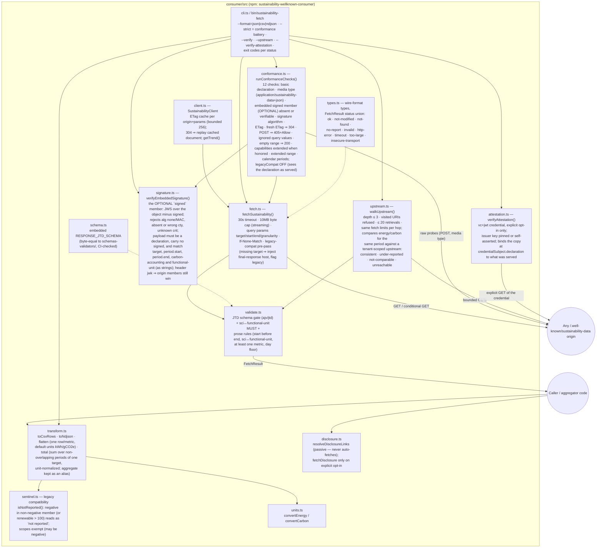

---

## 6. Deployment topologies

Because the HTTP semantics live in one framework-agnostic function
(`handleRequest` → `HandlerResult {status, headers, body}`), the same pipeline
deploys five ways. The draft only requires that `/.well-known/sustainability-data`
on the origin routes to *some* conformant responder:

1. **Standalone gateway** — the Node process from `server.ts`/`cli.ts` serves
   the endpoint directly (plus optional `carbon.txt` at both conventional paths).
2. **Embedded middleware** — `expressSustainability()` / `fastifySustainability()`
   mount the endpoint inside an existing app.
3. **Static file + web server** — for reports that change monthly, no runtime
   at all: generate once (`publisher --once`, or by hand, validated with
   `schemas-validators/`) and serve with the `server-configurations/` nginx
   `location` / Apache `Alias` snippets, which implement the draft's headers
   (media type, `Cache-Control`, automatic `ETag`/`Last-Modified`, CORS `*`,
   GET/HEAD-only with `405 + Allow`).
4. **Reverse proxy** — nginx/Apache/CDN in front of topology 1, proxying only
   the well-known path (with the commented rate-limiting snippets recommended
   for dynamic `start`/`end`/`granularity` queries).
5. **Serverless / edge** — any function handler that adapts its event to
   `handleRequest()`'s query/header inputs and its `HandlerResult` output.

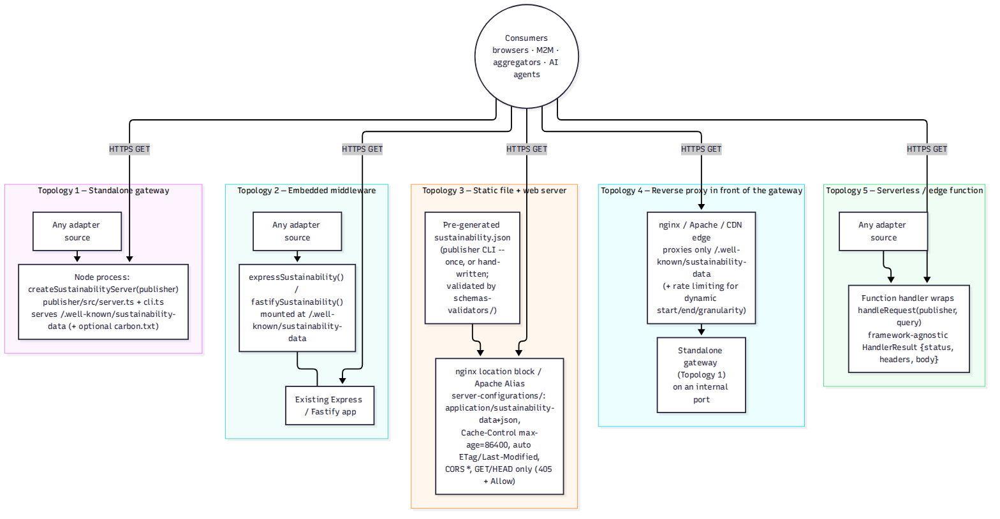

*Source: [`diagrams/deployment.mmd`](diagrams/deployment.mmd)*

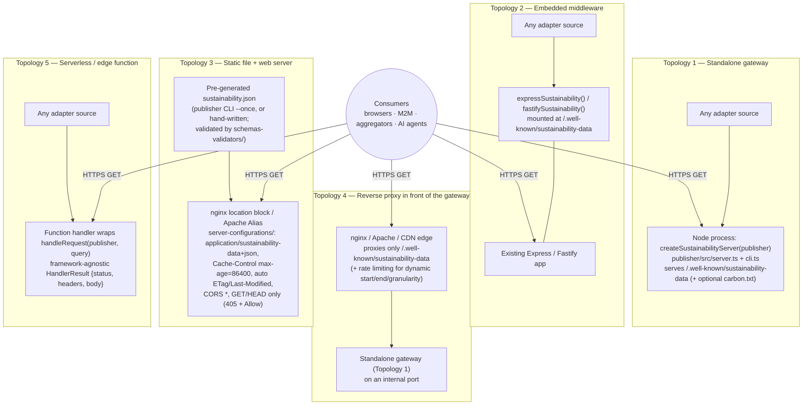

---

## 7. Supporting subsystems (schemas, example scripts, server configs)

* **`schemas-validators/`** — the single source of truth for the wire format:
  `response-schema.cddl` (RFC 8610, matches the draft's formal definition) and
  `response-schema.json` (RFC 8927 JTD). Two independent validators
  (`validator-cddl.py` via the Ruby `cddl` gem; `validator-json.py` via Python
  `jtd`) cross-check every example response. Both npm packages embed a copy of
  the JTD schema in their `schema.ts`; CI asserts that each embedded copy equals the
  canonical file as a JSON value (the CDDL and JSON files themselves are byte-identical), so the three copies cannot drift.
* **`example-scripts/`** — zero-dependency ports of the operational safeguards
  (`security.py/.js/.php`: 366-object cap — a `-06`-era mandate; `-07` makes it
  a consumer-side bound, see §3 — sub-daily filter, deterministic ~1% noise)
  and a complete stdlib-only reference request handler (`request-handler.py`)
  exercising the full Basic/Extended semantics — proof the protocol needs no
  framework.
* **`server-configurations/`** — the nginx/Apache snippets used by topology 3/4,
  live-tested in CI (below).
* **`example-responses/`** — 42 served examples covering every service level,
  member and closed-set value; all pass both validators against the `-10` schemas in
  `schemas-validators/`, which are byte-identical to the draft's own blocks.

## 8. CI / verification architecture

Twelve GitHub Actions workflows (`.github/workflows/`): ten verification workflows,
one daily live-deployment check and one publishing workflow:

| Workflow | Scope |
|---|---|
| `draft.yml` | Builds the latest draft with kramdown-rfc + xml2rfc, sanity checks, uploads the I-D artifact |
| `publisher.yml` | Typecheck, build and test the publisher, then validate a generated document with the Python (JTD) and Ruby (CDDL) validators (path-triggered, incl. schema paths) |
| `gateway.yml` | Builds and tests the reference gateway (`gateway/`), then runs the conformance battery against a live instance (path-triggered, incl. schema paths) |
| `consumer.yml` | Builds the **publisher first** (the consumer's `interop.test.ts` runs a live in-process producer→consumer round trip), then builds and tests the consumer |
| `example-scripts.yml` | Python/JS/PHP safeguard test suites, the `request-handler.py` end-to-end test, and the nginx and Apache configuration checks |
| `publish-github-packages.yml` | Mirrors the publisher and consumer npm packages to GitHub Packages as `@andreibesleaga/…` on `v*` tags or manual dispatch (npmjs.com stays canonical; already-published versions are skipped), and builds, smoke-tests and pushes the gateway image `ghcr.io/andreibesleaga/sustainability-wellknown-gateway` from `gateway/Dockerfile` |
| `full-verify.yml` | The umbrella: draft build + idnits3 in normal mode (no nit), the tools, the behaviour scenarios and fitness functions, dual-validator schema pass, both packages (typecheck/build/test/dry-run publish), the gateway with its conformance battery, example-script suites, **live nginx and Apache runs** of the `server-configurations/` snippets (curl-asserting 200 and `405 + Allow: GET, HEAD`), and a summary gate over all areas; runs weekly, by hand, and on changes to the schema corpus or `tools/report-to-declaration/` (each push is covered by the area workflows) |
| `bdd.yml` | The behaviour scenarios (`bdd/`) and the traceability check of every normative sentence of the draft |
| `deploy-kit.yml` | Every CI recipe of the deployment kit (`deploy/`) run in strict mode |
| `sfc-compliance.yml` | The SFC profile 2.0 checker and test vectors (`sfc-compliance/`) run against the published consumer |
| `self-check.yml` | The GitHub Action (`deploy/github-action/`) run on this repository |
| `live-deployments.yml` | Daily check of the origins listed in `implementations.json` |

Verification is thus layered exactly like the architecture: schema conformance
at the document level (dual validators), MUST-level behavior at the HTTP level
(conformance battery + live web-server checks), and cross-package interop at the
system level (the consumer validating what the publisher actually serves) — the
same JTD schema enforced, identically, at every layer.

---

## 9. Sources

* **C4 model** — Simon Brown, [c4model.com](https://c4model.com/): the
  hierarchical *System Context → Container → Component → Code* abstraction
  levels used here; definitions per
  [c4model.com/abstractions](https://c4model.com/abstractions) ("a **container**
  is an application or a data store — a separately runnable/deployable unit";
  a **component** is "a grouping of related functionality" within a container;
  **people** "use the software systems that we build"). The C4 model is
  notation-independent, which is why flowchart renderings of C4 levels are
  legitimate C4 diagrams.
* **Mermaid** — [mermaid.js.org](https://mermaid.js.org/): `flowchart`,
  `sequenceDiagram`, `classDiagram`, `stateDiagram-v2` syntax, and the
  [C4 diagram syntax](https://mermaid.js.org/syntax/c4.html), which Mermaid
  documents as **experimental** ("the syntax and properties can change in future
  releases"). Levels 1–2 were first authored in native `C4Context`/`C4Container`
  syntax; the experimental layout produced overlapping labels and unreadable
  stacking at this element count, so they were rewritten as `graph TD`
  equivalents styled with the standard C4 colour conventions (dark blue person /
  blue system-in-scope / grey external / dashed boundaries).
* Diagrams rendered with
  [`@mermaid-js/mermaid-cli`](https://github.com/mermaid-js/mermaid-cli)
  (`mmdc -s 2 -b white`).
* **Repository ground truth** — the `-12` draft (latest posted, 2026-10-28, the `-10` wire format; the active
  source for the protocol content in this document — see §3), with `-06` kept
  as the historical prior-posted reference, root `README.md`,
  `publisher/src/`, `consumer/src/`, `schemas-validators/`,
  `server-configurations/`, `example-scripts/`, and `.github/workflows/` as
  cited throughout.

## Directory map

```
architecture/
├── README.md                          # this document
├── diagrams/                          # Mermaid sources (one per diagram)
│   ├── c4-context.mmd                 # C4 L1 — system context
│   ├── c4-container.mmd               # C4 L2 — containers
│   ├── c4-component-publisher.mmd     # C4 L3 — publisher/src
│   ├── c4-component-consumer.mmd      # C4 L3 — consumer/src
│   ├── protocol-sequence.mmd          # wire-protocol lifecycle
│   ├── gateway-flow.mmd               # universal-gateway pipeline
│   ├── consumer-flow.mmd              # consumer fetch/validate/transform
│   ├── data-model.mmd                 # 26-member document model (per -10)
│   ├── version-state.mmd              # schema + draft revision lifecycles
│   └── deployment.mmd                 # five deployment topologies
└── images/                            # rendered PNGs (same basenames)
```
